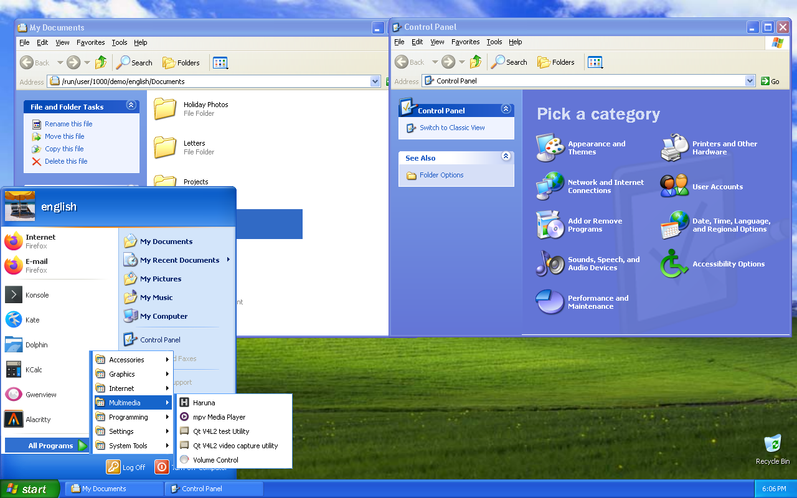
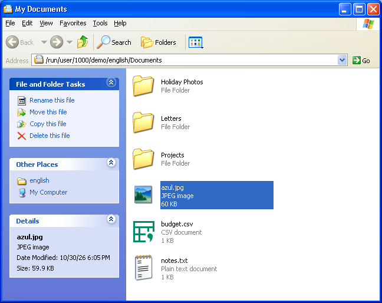
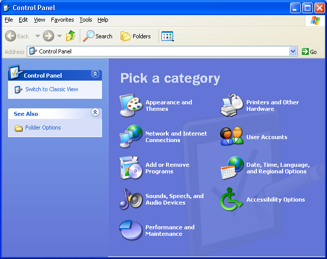
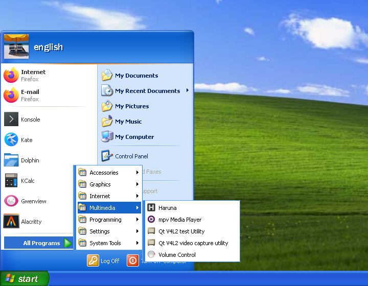

<h1 align="center">Winedows</h1>
<p align="center">
  
</p>
<p align="center">
  <strong>Linux のデスクトップを、Windows XP のシェルで。</strong>
</p>
<p align="center">
  <a href="../../LICENSE"></a>
  
  
  
</p>
<p align="center">
  <a href="../../README.md">English</a> ·
  <strong>日本語</strong>
</p>

> [!IMPORTANT]
> **個人の実験的なプロジェクトです。** 日常の作業環境として使えるほど完成してはいません。
> 動作を確かめているのは、**新しくインストールした Debian 13** に導入スクリプトで入れた場合だけです。
> すでに使っている環境（ほかのデスクトップ環境やディスプレイマネージャが入っているものなど）への導入は試していません。
> 試すときは、仮想マシンや試験用のマシンをおすすめします。

## これは何？

Windows XP の `explorer.exe` を、パッチを当てた Wine の上で **Linux のデスクトップシェル**として動かすプロジェクトです。
タスクバー、スタートメニュー、デスクトップ、フォルダウィンドウは XP 本物のものです。Linux のアプリも、XP の枠とタスクバーで扱えます。

Microsoft のファイルは同梱していません。お手元の XP の ISO から、必要なファイルだけを取り出して使います。

XP の ISO が無い方は、XP のシェルの代わりに **[ReactOS](https://reactos.org/) のシェル**（Windows 2000 風のクラシックの見た目）でも
試せます。ReactOS は自由なソフトウェアなので、導入スクリプトが公式のリリースから取得します（[docs/reactos.md](../../docs/reactos.md)）。

Winedows は [mikuta0407/win4wine](https://github.com/mikuta0407/win4wine) のフォークから始まりました。中の名前
（`win4wine-*` のパッケージ、`~/.config/win4wine` など）はそのままなので、入れてある環境はそのまま使えます。

### Windows ごとのブランチ

| ブランチ | シェル |
|---|---|
| **`WinXP`**（このブランチ） | Windows XP（Luna かクラシック）、XP の ISO が無いときの ReactOS のシェル、XP Explorer（[xp-explorer/](../../xp-explorer/README.md)） |
| [`Win7`](../../../../tree/Win7) | Windows 7 |

`master` はこの 2 つへの案内だけです。

## 軽さ

XP の推奨メモリは 128 MB で、Wine の上でも XP のシェルは小さいままです。ログオン直後の XP のセッション全体
（X11、1280×800、Luna、通知領域のネットワーク・音量・セキュリティ センター・Messenger が動いている状態）の
全プロセスの PSS（共有のページを、それを使うプロセスで割ったもの）を足した値です。

| 部分 | プロセス | メモリ（PSS） |
|---|---|---:|
| Wine の上の XP のシェル | `explorer.exe`、XP の通知領域とスタートメニューの補助、XP のサービス、`wineserver` | 約 300 MB |
| セッション | X11 のウィンドウマネージャー、トレイの仲介、supervisor、Linux のアプリの一覧、GTK のテーマの監視 | 約 130 MB |
| Linux のデスクトップのサービス | D-Bus、XDG ポータル、gvfs | 約 65 MB |
| X サーバー | | 約 30 MB |
| **合計** | 45 プロセス | **約 520 MB** |

比べると、GNOME や KDE Plasma はログオン直後にふつう 1 GB 以上を使います。

ディスクは、Wine のビルドが約 1.5 GB（デバッグ情報込み）、XP の ISO から取り出すファイルが約 160 MB で、
Wine の prefix は入れる Windows のプログラムの分だけ増えます。Wine のビルドには一度だけ約 40 GB が要ります。

## できること

- **XP のシェル**: Luna（またはクラシック）のタスクバー、スタートメニュー、デスクトップ、マイ コンピュータ、フォルダウィンドウ。
- **Linux アプリとの統合**: Linux のウィンドウに XP の枠が付き、タスクバー、Alt+Tab、最小化・最大化が XP と同じように動きます。
  Linux のアプリは「すべてのプログラム」に並びます。
- **通知領域**: Linux のトレイアイコン（StatusNotifierItem と XEmbed）が XP の通知領域に出ます。
  XP 自身のネットワーク・バッテリー・音量のアイコンと、そのフライアウト（音量、電源メーター、ワイヤレス ネットワーク接続の状態）、XP のボリューム コントロールも
  出ます。NetworkManager と PipeWire / PulseAudio の状態から作ります（XP Explorer から。[xp-explorer/](../../xp-explorer/README.md)）。
  ワイヤレス ネットワークの一覧から、初めてのネットワークにも XP のネットワーク キーの画面で接続できます。メニューや画面の文字は ISO の XP のファイルから読みます。
- **XP Explorer からの追加**: フォルダの左のタスク ペイン、画面のプロパティ（Windows XP とクラシックのテーマ、スタイルと配色。
  配色は ISO の HIVEDEF.INF と themeui.dll から作ります）、画像の縮小版とプレビュー、XP のサウンド（起動、ログオン、ログオフも）、
  ネットワーク接続、Internet Explorer 6、検索コンパニオン（犬の Rover）、Windows Media Player 9、スタートメニューの左の列（インターネット、電子メール、
  よく使うプログラム）、ユーザー アカウント（「画像の変更」で XP の 23 枚の画像から選ぶと、スタートメニューと Linux のユーザーの画像も
  変わります）、XP のネットワーク接続のフォルダ（Linux の有線・無線のアダプタと状態。通知領域のネットワークのアイコンから開きます）と
  XP の「ワイヤレス ネットワークの選択」（NetworkManager の Wi-Fi の一覧と接続）、プログラムの追加と削除（スタートメニューの
  「プログラムのアクセスと既定の設定」も。Linux のアプリも並び、削除はパッケージ マネージャーで、既定のプログラムは Linux の既定に
  なります）、セキュリティ センター（自動更新、インターネット オプション）、ヘルプとサポート センター（XP のヘルプのトピックと
  そのサービス。スタートメニューの「ヘルプとサポート」から開きます）、XP のファイルの種類（HIVECLS.INF の名前とアイコン、
  .zip の圧縮フォルダ、Windows Installer パッケージ、Windows Media Player の音楽と動画の種類）。
  どれもお手元の ISO のファイルで動きます（`prefix/extras.py`）。
- **XP 自身のプログラムと「すべてのプログラム」**: XP の電卓、メモ帳、ペイント、ワードパッド、コマンド プロンプト、タスク マネージャ、
  レジストリ エディタ、文字コード表、サウンド レコーダー、ボリューム コントロール、拡大鏡、スクリーン キーボード、ハイパーターミナル、
  リモート デスクトップ接続、ゲーム（フリーセル、ハート、マインスイーパ、ピンボール、ソリティア、スパイダ ソリティア）、
  Windows Messenger が Wine のものの代わりになります。「すべてのプログラム」は ISO のセットアップの INF からその言語で作る XP 自身のもので
  （上に Windows Update、Windows カタログ、プログラムのアクセスと既定の設定、その下にアクセサリ、ゲーム、スタートアップ、XP のプログラム）、
  Linux のアプリはその中の「Linux アプリケーション」のフォルダにあります（`prefix/startmenu.py`）。
- **キーボードの配列**: 最初は Linux のシステムの配列（`localectl`）です。コントロール パネルの「地域と言語のオプション」→
  「言語」→「詳細」（XP 自身のもの）で入力言語を足したり既定を変えたりすると、セッションの配列（Wayland では labwc、
  X11 では setxkbmap）がすぐに従います。2 つ以上なら XP と同じ左 Alt+Shift で切り替わります（`session/keyboard.py`）。
- **日本語入力**: fcitx5 + Mozc です。Ctrl+Space（または全角/半角）で切り替えます。GTK、Qt、Wine のアプリで使えます。
- **日本語版と英語版の XP**: どちらの ISO でも動きます。言語は ISO から自動で判断し、字体（英語版は Tahoma など）、
  ロケール、ようこそ画面をその XP に合わせます（英語版では日本語入力は設定しません）。
- **Windows のアプリ**: WoW64 の Wine 11.0 で、32bit と 64bit のアプリが動きます。端末で `wine setup.exe` と打つと、
  インストーラーが作るショートカットは XP のスタートメニューに入ります。
- **XP のようこそ画面**: LightDM の greeter として、XP のようこそ画面とログオフの画面を出せます（任意）。
  シェルが起動するまでは XP と同じ大きな「ようこそ」の画面を出します。
- **XP のキー操作**: Windows キー、Ctrl+Esc、Win+R、Win+E が使えます。
- **クイック起動**: タスクバーの右クリック →「ツール バー」→「クイック起動」で出せます（XP と ReactOS）。スタートメニューから Linux のアプリのショートカットも置けます。
  「デスクトップの表示」も実機と同じく、もう一度押すと窓が元に戻ります。
- **画面の拡大（DPI）**: XP と同じ「DPI 設定」で、文字や部品を大きくできます（96・120・144 など）。
- **落ちても戻れる**: XP のシェルが繰り返し落ちると、Wine 標準の explorer と xterm に切り替わります。
- **Wayland のセッション（任意・X11 のセッション以上に実験的）**: X11 のウィンドウマネージャーの代わりに、パッチを当てた labwc で
  動かすセッションです（XP と ReactOS のシェル）。モニターごとの倍率や 125%・150% などの倍率が使え、シェルはぼけずに描かれます。
  Wayland のアプリにもシェルの枠が付きます。作ったばかりで、確かめた範囲は X11 のセッションより狭く、既知の制限もあります（[docs/wayland.md](../../docs/wayland.md)）。
  ふだん試すなら X11 のセッションをおすすめします。
- **ReactOS のシェル（任意）**: XP の ISO の代わりに ReactOS 0.4.16 の explorer で動かすセッションです。日本語と英語に対応します。
  XP のシェルと並べて入れられます。
- **XP Explorer（任意）**: セッションを置き換えず、KDE などの今のデスクトップの上で、Wine の仮想デスクトップの窓の中に
  XP のシェルを開きます（[xp-explorer/](../../xp-explorer/README.md)）。

<table>
  <tr>
    <td align="center" width="50%">
      <br />
      XP のクラシック（<code>--theme classic</code>）
    </td>
    <td align="center" width="50%">
      <br />
      ReactOS のシェル（<code>--shell reactos</code>。XP の ISO は要りません）
    </td>
  </tr>
</table>

## 試してみる

1. Windows XP Professional SP3（x86）の ISO（日本語版か英語版）を**ご自身で**用意してください。
2. 新しくインストールした Debian 13 に、ログインして使う利用者として入り、次を実行します。

```sh
git clone -b WinXP https://github.com/AshesTom/Winedows.git ~/winedows
cd ~/winedows
scripts/setup.sh --media /path/to/WindowsXPSP3.iso --greeter
```

3. 再起動すると、XP のようこそ画面からそのまま XP のシェルに入ります。

XP の ISO が無いときは、ReactOS のシェルで試せます（ISO は要りません）。

```sh
scripts/setup.sh --shell reactos --lang ja   # 英語なら --lang en
```

ログイン画面でセッション「ReactOS Shell (Wine, X11)」を選びます。

詳しい手順とオプションは 🔗 [導入手順（INSTALL.md）](../../INSTALL.md) にあります。Wine をソースからビルドするので、4 コアで 1 時間半ほどかかります。
テーマ（XP のクラシックなど）と文字の大きさは、後から変えられます（[見た目と文字の大きさを変える](../../INSTALL.md#見た目と文字の大きさを変える)）。

## 注意

> [!WARNING]
> - **Windows XP の ISO はご自身で入手してください。** このリポジトリにも導入スクリプトにも、Microsoft のファイルを
>   取得する処理はありません。ISO と取り出したファイルの扱いは、Microsoft の使用許諾に従ってください。
> - **利用は自己責任でお願いします。** データの損失や不具合について、作者は責任を負いません。
> - Microsoft とも Wine プロジェクトとも関係のない、非公式のプロジェクトです。
> - 確かめているのは日本語版と英語版の XP SP3（x86）だけです。ほかの言語の XP も英語版と同じ設定で入れるので動くかもしれませんが、
>   一切試していません（`setup.sh` は警告を出して続けます）。

## ネイティブモード（開発中）

Winedows を Linux そのものに移植しています。`native-shell/` は XP のシェルを **Linux のネイティブなプログラム**として書き直したもので、
いずれ **Wine を完全に置き換えます**。XP のコードは実行しません。お手元の XP のファイルからは資源（ビジュアルスタイルの画像、文字列、アイコン、
ダイアログ、フォント、壁紙）だけを実行時に読みます。

デスクトップとそのアイコン、タスクバー、スタートメニュー、XP の窓の枠、画面のプロパティ（テーマの切り替えがその場で反映され、Qt と GTK のアプリにも効きます。自分のテーマも取り込めます）、
ファイル操作のできるフォルダウィンドウ、アニメーションキャラクターと Bing での Web 検索付きの検索コンパニオン、コントロールパネルがすでにあります。XP の多くの部分はまだなく、試したのも CachyOS の上のウィンドウの中だけなので、
**まだ Wine のセッションの代わりにはなりません**。今のデスクトップのウィンドウの中で、Wine も prefix もなしで試せます。

```sh
./xp.sh native /path/to/WindowsXPSP3.iso   # 2 回目からは ./xp.sh native --
```

動くものと残っているもの: [docs/native-shell.md](../../docs/native-shell.md)（英語）

<table>
  <tr>
    <td align="center" width="50%">
      <br />
      <strong>通常モード</strong>: Wine の上で動く XP の <code>explorer.exe</code>
    </td>
    <td align="center" width="50%">
      <br />
      <strong>ネイティブモード</strong>: Wine を使わない Linux のプログラム（画面は英語版の XP のファイルから）
    </td>
  </tr>
</table>

<table>
  <tr>
    <td align="center" width="33%">
      <br />
      エクスプローラ
    </td>
    <td align="center" width="33%">
      <br />
      コントロールパネル
    </td>
    <td align="center" width="33%">
      <br />
      スタートメニュー
    </td>
  </tr>
</table>

## 仕組み

```text
LightDM ─ XP のようこそ画面 (greeter/)
   └─ XP Shell セッション (session/supervisor.py)
        ├─ Wine 11.0 + 183 本のパッチ (wine/patches/)
        │    └─ XP の explorer.exe, shell32.dll, …（ISO から取り出したもの。ReactOS のシェルでは ReactOS のもの）
        ├─ bridge-wm: X11 のウィンドウマネージャー + Win32 の代理ウィンドウ (bridge-wm/)
        │    （Wayland のセッションでは、ウィンドウマネージャーの代わりにパッチを当てた labwc。wayland/）
        └─ fcitx5 + Mozc, トレイの仲介 (bridge-wm/tray.py)
```

仕組みや設計の詳しい説明は [docs/](../../docs/README.md) にまとめています。

## 似たプロジェクト

- [loss32](https://loss32.org/): Wine の上の Win32 のソフトウェアだけでデスクトップを作る Linux ディストリビューションの計画です。
  ReactOS の部品も使います。Winedows が XP 本物のシェルを Debian の上で動かすのに対し、loss32 は自由なソフトウェアだけで作ります。

## 守っていること

- Windows 由来のバイナリには手を加えません。違いは Wine とその周辺で吸収します。
- Microsoft のバイナリを逆アセンブルしません。挙動は公開 API と、実際の XP の上で動かす自作のプローブで調べています。
- Microsoft のファイル、取り出したもの、Wine の prefix は、Git 管理外の `localres/` と `.local/` にだけ置きます。

## 作った人

- [mikuta0407](https://github.com/mikuta0407) さん: このプロジェクトの元の [win4wine](https://github.com/mikuta0407/win4wine)。
  パッチを当てた Wine、bridge-wm、セッション、ようこそ画面、XP・ReactOS・Windows 7 のシェル。
- [AshesTom](https://github.com/AshesTom) さん: XP の画面のプロパティ、
  サウンド、キーボードの配列、通知領域の XP のアイコン、スタートメニューの左の列、Internet Explorer 6 と Windows Media Player 9、
  起動中のようこそ画面、タイトルバーのアニメーションと小さいアイコン、Arch Linux への対応、`xp.sh` など。

## ライセンス

[LGPL-2.1-or-later](../../LICENSE)（Wine と同じ）です。対象はこのリポジトリのコードとパッチだけです。
ただし `wayland/patches/labwc/` は labwc と同じ GPL-2.0-only、`wayland/patches/wlroots/` は wlroots と同じ MIT です。
Windows XP のファイルと、スクリーンショットに写っている XP の画面の著作権は Microsoft にあります。
ReactOS のシェルで使う ReactOS のファイルは、ReactOS のライセンス（GPL-2.0-or-later、DLL の多くは LGPL-2.1-or-later）に従います。
