<h1 align="center">Winedows: native shell</h1>
<p align="center">
  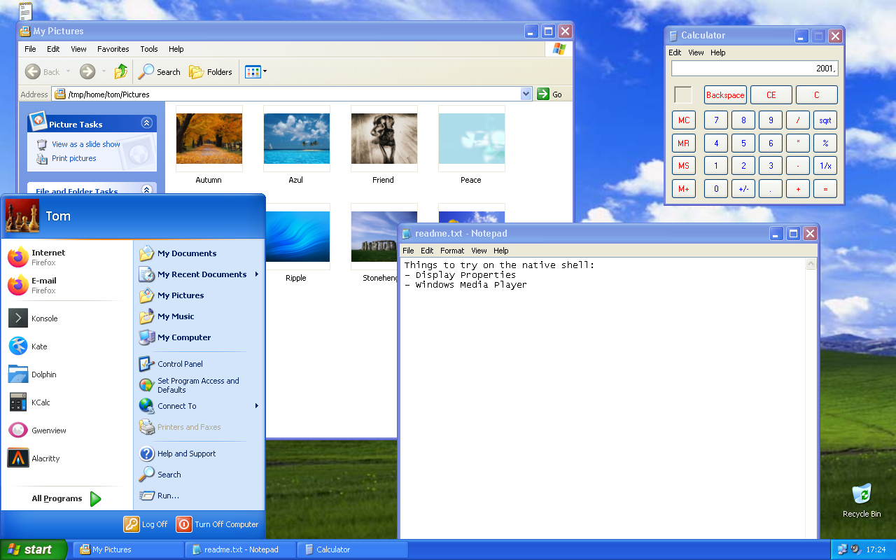
</p>
<p align="center">
  <strong>The Windows XP desktop, rebuilt as Linux programs. No Wine, no Windows code.</strong>
</p>
<p align="center">
  <a href="LICENSE"></a>
  
  
  
  
</p>

> [!IMPORTANT]
> **This is a personal, experimental project**, not a finished desktop for daily use. It has been tried on
> CachyOS (Arch Linux) only, mostly in a window of another desktop. Try it in a window or a virtual machine first.

## What it is

Winedows' native shell is XP's `explorer.exe` **ported to Linux**: the desktop, the taskbar, the Start menu, the
folder windows and the Control Panel are a Qt 6 program, and Notepad, the Calculator, the Command Prompt, the Picture
and Fax Viewer and Windows Media Player 9 are Linux programs of their own beside it, as they were on XP.

None of XP's code runs. Your own XP CD only gives the shell its **resources**, read at run time: the Luna visual
style's art and metrics, the strings, menus and dialogs of `explorer.exe`, `shell32.dll` and the control panels, the
icons, sounds, fonts and wallpapers. So every word and picture on screen is XP's own, in the language of your CD,
and no Microsoft file is included in this repository.

Linux applications live in it too: they get XP's window frames and taskbar buttons, their tray icons show up in XP's
notification area, and they are listed under All Programs.

> This branch (`nativeshell`) holds the native session alone. The original Winedows, which runs XP's real
> `explorer.exe` on a patched Wine, lives on the [`WinXP`](../../tree/WinXP) branch.

## Screenshots

<table>
  <tr>
    <td align="center" width="50%">
      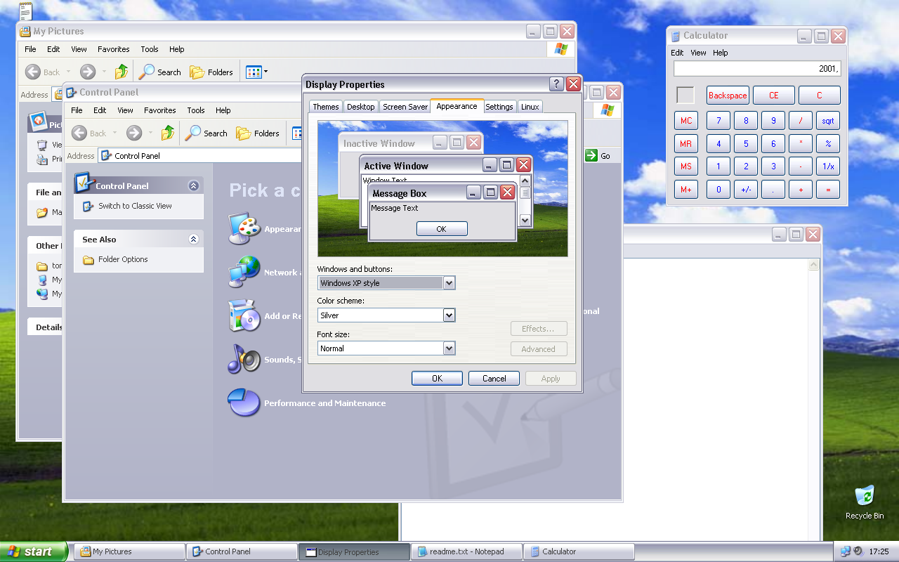<br />
      Display Properties: switching to <strong>Silver</strong> repaints every window at once
    </td>
    <td align="center" width="50%">
      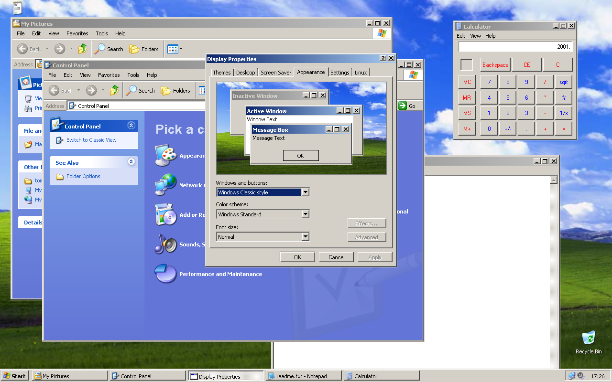<br />
      The same desktop in <strong>Windows Classic</strong>
    </td>
  </tr>
</table>

<table>
  <tr>
    <td align="center" width="33%">
      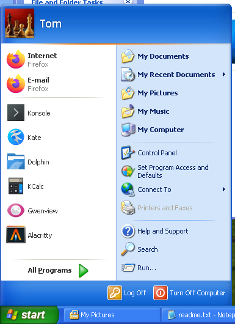<br />
      Start menu
    </td>
    <td align="center" width="33%">
      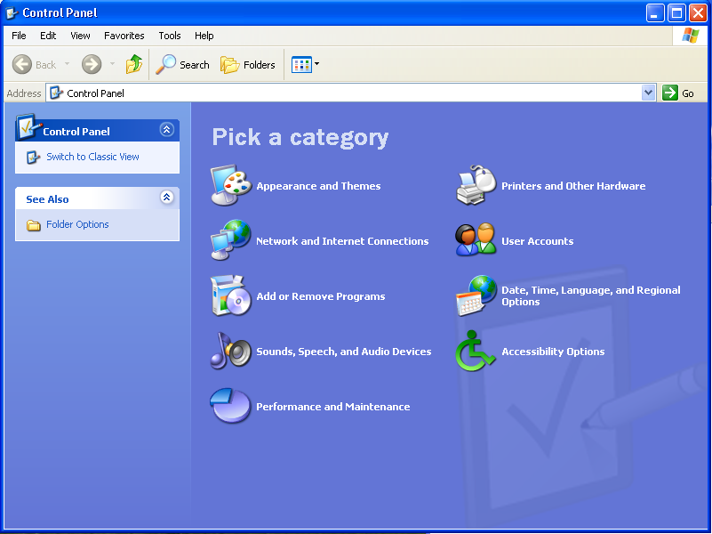<br />
      Control Panel
    </td>
    <td align="center" width="33%">
      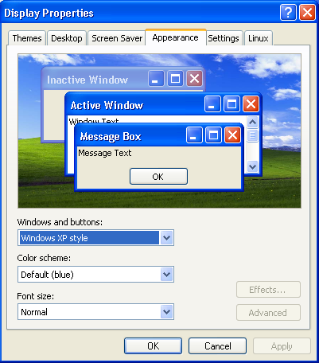<br />
      Display Properties
    </td>
  </tr>
  <tr>
    <td align="center" width="33%">
      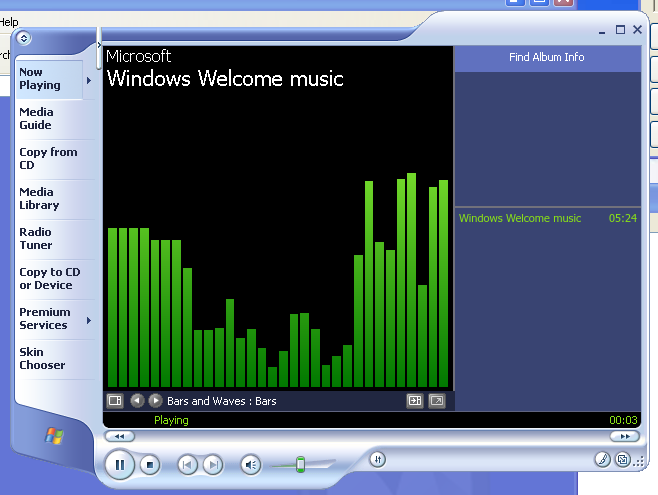<br />
      Windows Media Player 9, drawn from its own compiled skins
    </td>
    <td align="center" width="33%">
      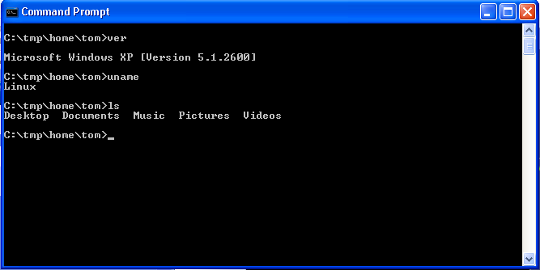<br />
      Command Prompt, running bash in XP's raster font
    </td>
    <td align="center" width="33%">
      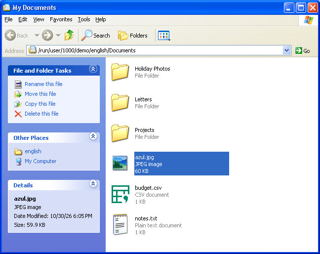<br />
      Folder windows
    </td>
  </tr>
</table>

## The installer

`install.sh` installs the session the way XP's own setup looked, in its three phases. Their words, pictures and
layout are read from `usetup.exe`, `winntbbu.dll` and `syssetup.dll` on your CD; the billboard's geometry was worked
out from `winntbbu.dll` itself ([docs/setup.md](docs/setup.md) says where each value comes from).

<table>
  <tr>
    <td align="center" width="50%">
      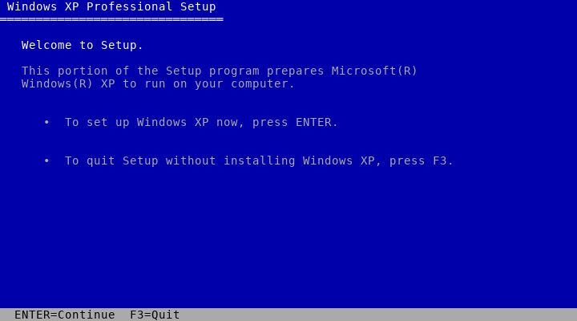<br />
      <strong>1. Text mode</strong>, in your terminal: Welcome to Setup, the licence (F8)…
    </td>
    <td align="center" width="50%">
      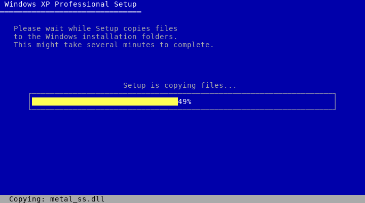<br />
      …and the copy gauge, while XP's files are taken from the CD and the programs built
    </td>
  </tr>
  <tr>
    <td align="center" width="50%">
      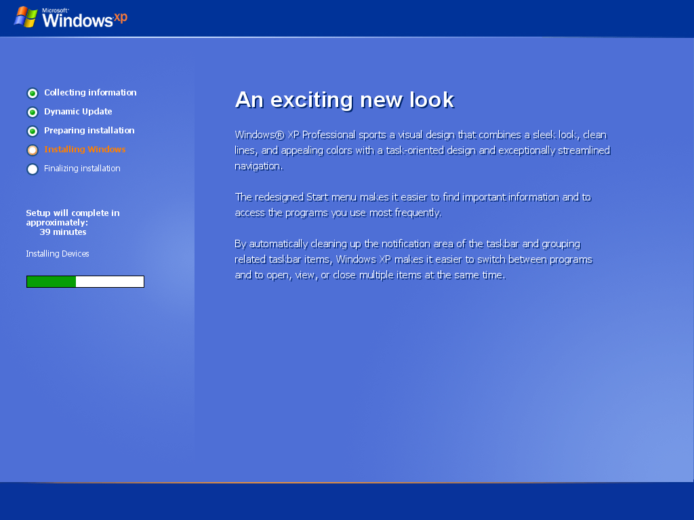<br />
      <strong>2. The billboard</strong>, full screen, while the session is installed
    </td>
    <td align="center" width="50%">
      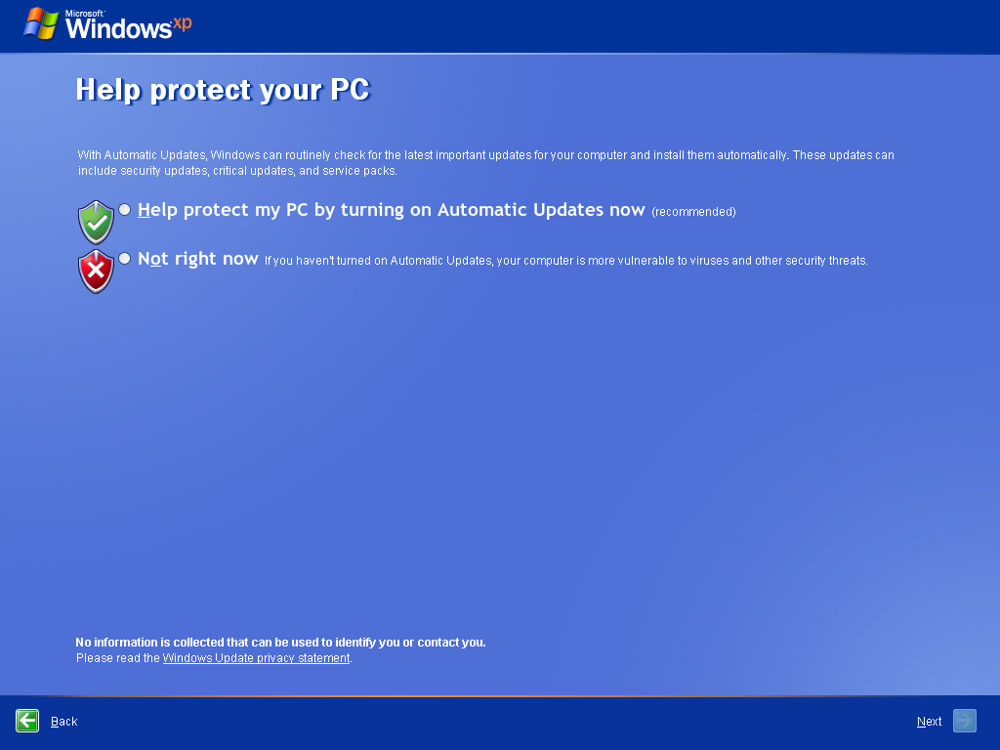<br />
      <strong>3. Windows Welcome</strong> at the first logon
    </td>
  </tr>
</table>

## Try it

You need a **Windows XP Professional SP3 (x86) CD image**, English or Japanese, that you got yourself.

Install what it is built with (Arch Linux and its derivatives; Debian's package names are in `install.sh`):

```sh
sudo pacman -S --needed cmake qt6-base qt6-multimedia qt6-declarative libarchive python-xlib python-gobject python-cairo
```

**In a window of your current desktop**, without touching anything on your system:

```sh
git clone -b nativeshell https://github.com/AshesTom/Winedows.git
cd Winedows
./xp.sh /path/to/WindowsXP-SP3.iso       # later runs: ./xp.sh --
```

The first run takes the files the shell needs from the CD into `.local/native-assets` and builds the programs.
`./xp.sh -- 1600x900` picks another size; `./xp.sh oobe` shows Windows Welcome alone.

**The installer, as a demo**: every screen of the three phases, with nothing built, copied or registered.

```sh
./xp.sh setup-demo /path/to/WindowsXP-SP3.iso   # later runs: ./xp.sh setup-demo
```

**For real**:

```sh
./install.sh --media /path/to/WindowsXP-SP3.iso --system
```

It installs the session in `~/.local/opt/winedows`. `--system` adds **Windows XP (native)** to your display
manager's sessions, and `--greeter` also makes XP's Welcome screen LightDM's login screen (both ask for `sudo`).

## What's in it

- **Desktop**: Bliss or your wallpaper, the desktop's icons and their shortcut menus, Arrange Icons, the Recycle Bin.
- **Taskbar**: Luna or Classic, buttons sized and grouped as XP's taskband does it, the notification area with Linux
  tray icons and XP's volume and network icons, the clock, Taskbar and Start Menu Properties.
- **Start menu**: XP's two columns, your picture and name, recent programs, All Programs and My Recent Documents,
  Log Off and Turn Off Computer with XP's dialogs.
- **Folder windows**: the Common Tasks pane, the Folders tree, Thumbnails, Tiles, Icons, List, Details and
  Filmstrip; copy, move and delete with XP's progress windows, the Recycle Bin, Properties, Send To, and the Search
  Companion with its character.
- **Control Panel**: category and classic views. Display Properties has themes, visual styles, colour schemes and
  imported `.msstyles`, applied live to the shell and to Qt and GTK programs. Also System, Date and Time, User
  Accounts, Sounds, Mouse, Keyboard, Folder Options, Fonts, Network Connections and more.
- **XP's programs**: Notepad, the Calculator (Standard and Scientific, 32 digits), the Command Prompt, the Picture
  and Fax Viewer, and Windows Media Player 9 with its skins.
- **Window frames** for Linux applications, drawn from the visual style: rounded corners, the three buttons, the
  system menu, moving and sizing from every edge.
- **Session**: XP's sounds, the Windows key shortcuts, Windows Welcome at the first logon, Switch User and the
  Welcome screen, Log Off and Turn Off.

The full list, and what is not ported yet: [docs/native-shell.md](docs/native-shell.md).

## How it works

```text
display manager ─ "Windows XP (native)" (native-shell/session.sh)
   ├─ Windows Welcome, once (greeter/xp-native-oobe.py)
   ├─ bridge-wm/wm.py        X11 window manager: XP's frames for every window
   ├─ bridge-wm/tray.py      Linux tray icons → XP's notification area
   ├─ explorer               desktop, taskbar, Start menu, folders, Control Panel   (C++ / Qt 6)
   │    └─ notepad, calc, cmd, shimgvw, wmplayer     XP's programs, each its own binary
   └─ qt-style/              XP's look for the other Qt and GTK programs

your XP CD ─ native-shell/extract.py ─▶ .local/native-assets   (resources only, read at run time)
```

| Folder | What is there |
|---|---|
| [`native-shell/`](native-shell) | The shell (`src/`), XP's programs (`apps/`), the session script and `extract.py` |
| [`qt-style/`](qt-style) | The visual style reader (`msstyles`), and the Qt style and GTK module that draw with it |
| [`bridge-wm/`](bridge-wm) | The window manager and the tray bridge |
| [`greeter/`](greeter) | The Welcome screen, Windows Welcome (the OOBE) and their resource reader |
| [`setup/`](setup) | The installer's three phases |

More: [docs/native-shell.md](docs/native-shell.md) (the shell, part by part),
[docs/reverse-status.md](docs/reverse-status.md) (what was studied in XP's files, and how),
[docs/setup.md](docs/setup.md) (the installer).

## Caution

> [!WARNING]
> - **Get the Windows XP CD yourself.** Neither this repository nor its scripts download any Microsoft file.
>   Follow Microsoft's licence terms for the CD and the files taken from it.
> - Files taken from the CD stay in `.local/`, which Git ignores.
> - **Use at your own risk.** This is an unofficial project, not affiliated with Microsoft.

## Credits

- [mikuta0407](https://github.com/mikuta0407) wrote [win4wine](https://github.com/mikuta0407/win4wine), which
  Winedows started from: bridge-wm, the session and the greeters come from it.
- [AshesTom](https://github.com/AshesTom): Winedows and its native shell.

## License

[LGPL-2.1-or-later](LICENSE). It covers only the code in this repository. The Windows XP files, and the XP screens
in the screenshots, are copyrighted by Microsoft.
