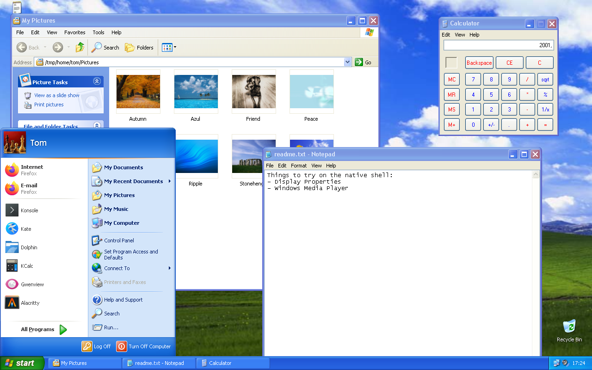
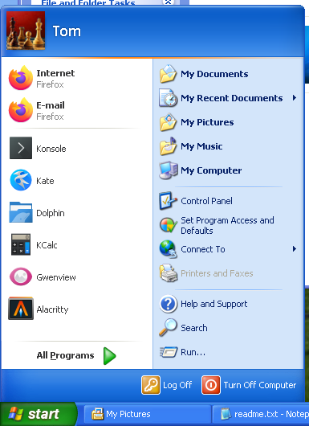
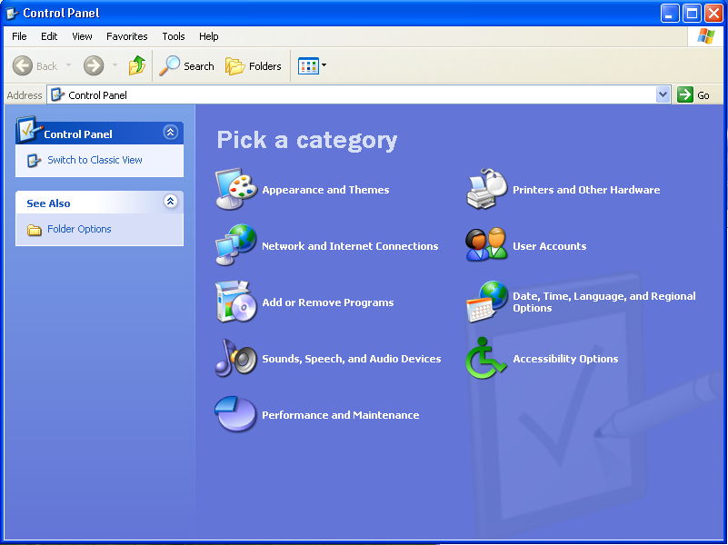
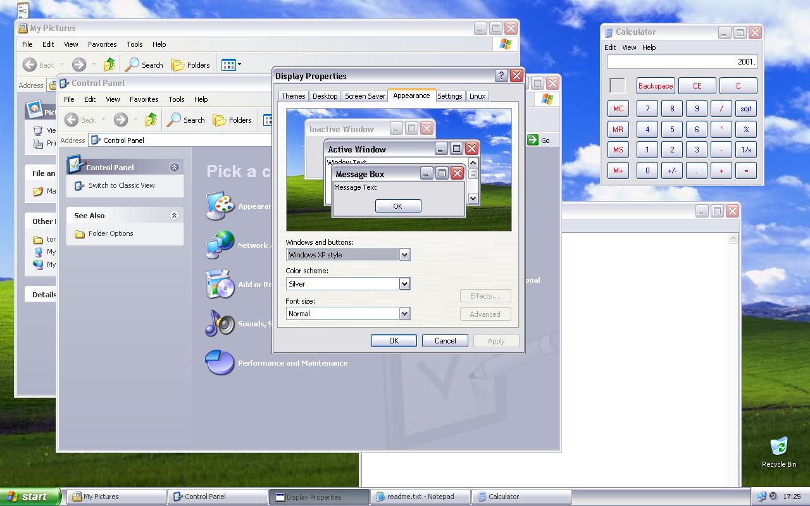
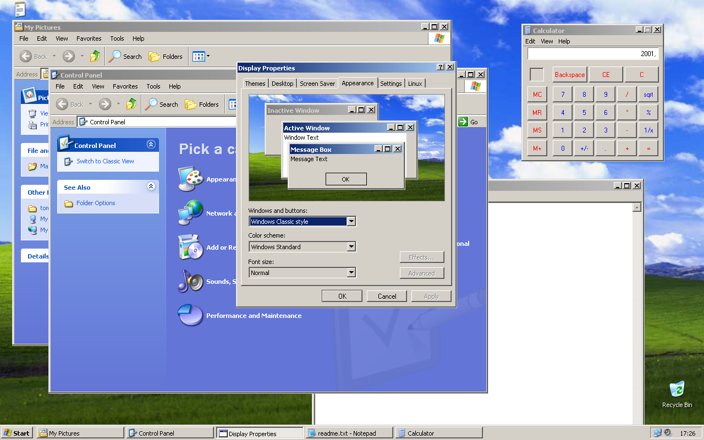
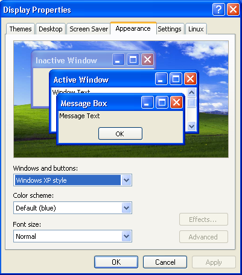
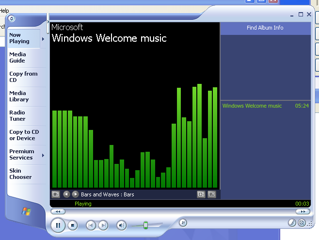
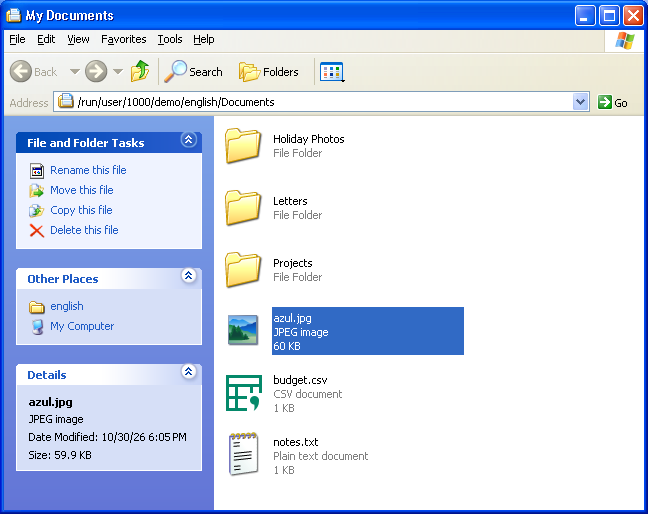
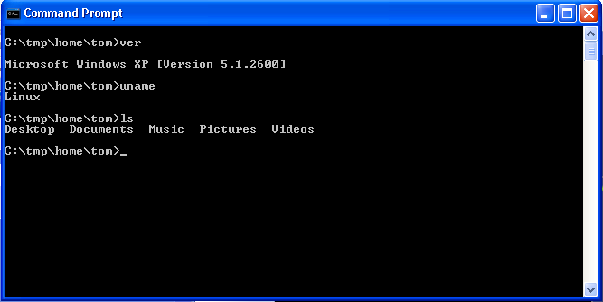

# Winedows

A Windows XP desktop for Linux, written in C++ with Qt 6. It does not use Wine and contains no Windows code:
the visual resources (theme, icons, strings, sounds, fonts) are read from your own Windows XP ISO.



## Screenshots

| | |
|---|---|
|  |  |
|  |  |
|  |  |
|  |  |

## Features

- Desktop, taskbar, Start menu, Explorer windows and Control Panel
- Luna (Blue, Olive Green, Silver) and Windows Classic, applied to Qt and GTK applications
- Notepad, Calculator, Command Prompt, Picture and Fax Viewer, Windows Media Player, Internet Explorer, Help and Support Center
- Minesweeper, Solitaire, FreeCell, Spider Solitaire, Hearts
- XP window frames, taskbar buttons and tray icons for Linux applications
- Installer, logon screen and first-run setup

Details and missing parts: [docs/native-shell.md](docs/native-shell.md).

## Requirements

- Linux with X11 (tested on CachyOS / Arch Linux)
- A Windows XP Professional SP3 x86 ISO, English or Japanese
- Build dependencies:

```sh
sudo pacman -S --needed cmake qt6-base qt6-multimedia qt6-declarative libarchive python-xlib python-gobject python-cairo
```

Debian package names are listed in `install.sh`.

## Installation

Try it in a window, without installing anything:

```sh
git clone -b nativeshell https://github.com/AshesTom/Winedows.git
cd Winedows
./xp.sh /path/to/windows-xp.iso
```

Install it as a session:

```sh
./install.sh --media /path/to/windows-xp.iso --system
```

The session is installed in `~/.local/opt/winedows`. `--system` adds "Windows XP (native)" to the display manager,
`--greeter` also sets the XP logon screen as the LightDM greeter. Both require `sudo`.

The installed size is about 85 MB.

## Project layout

| Folder | Contents |
|---|---|
| `native-shell/` | Shell, applications, session script, ISO extraction |
| `qt-style/` | Visual style reader, Qt style and GTK module |
| `bridge-wm/` | Window manager and tray bridge |
| `greeter/` | Logon screen and first-run setup |
| `setup/` | Installer |

## Notice

This is an experimental, unofficial project, not affiliated with Microsoft. No Microsoft files are distributed:
you must provide your own Windows XP ISO. Files extracted from it stay in `.local/`.

The Wine-based version (branches `WinXP` and `Win7`) is discontinued.

## License

LGPL-2.1-or-later, for the code in this repository only. Windows XP and its files are copyrighted by Microsoft.
Originally forked from [mikuta0407/win4wine](https://github.com/mikuta0407/win4wine).
